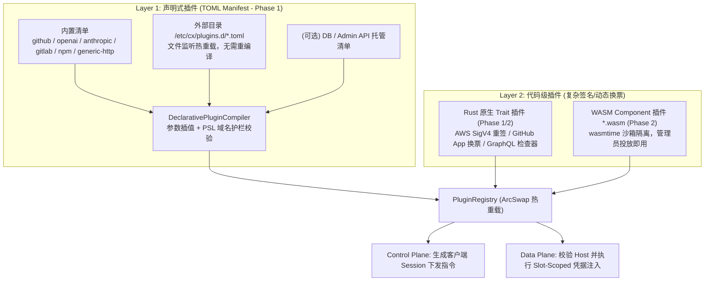

# `cx` 插件化域名与凭据注入系统规范

> **文档编号**: SPEC-002  
> **关联文档**: [SPEC-001: `cx` 技术架构设计方案](./001-cx-architecture.md)  
> **所属模块**: `crates/cx-plugin` + `plugins/`  
> **目标**: 将「服务端可注入哪些域名」「如何解析/替换凭据」「如何下发客户端虚拟 Key 与 CLI 适配参数」彻底解耦为插件体系，实现**零硬编码、零客户端升级即可扩展新上游服务**，同时保持严格的域名安全边界。

---

## 1. 核心设计思想

### 1.1 插件（Provider Plugin）与 Profile 的职责分离

为了避免把「协议适配逻辑」和「团队权限/实例配置」混在一起，系统严格区分两层概念：

| 层次 | 概念 | 职责 | 生命周期与管理者 |
| :--- | :--- | :--- | :--- |
| **能力模板层** | **Provider Plugin**（如 `github`、`openai`、`gitlab`、`aws-s3`） | 定义该类服务支持哪些域名（支持参数化，如自建 GHE/GitLab）、需要什么密钥字段、按域名怎么注入 Header/BasicAuth/签名、客户端需要注入什么环境变量/钩子、内置哪些推荐策略模板 | 内置编译或由管理员放入 `/etc/cx/plugins.d/`（支持热加载） |
| **授权实例层** | **Profile**（如 `github-org-ro`、`ghe-prod`、`openai-dev`） | 选择一个 Plugin，填入具体参数（如自建域名）、绑定一条真实加密 Credential、可**收窄**域名范围、配置 OIDC Group 访问权限与细粒度 L7 策略 | 管理员在 `cx-server.toml` 或数据库 / Admin API 中管理 |

**核心收益**：
1. **客户端零升级**：`cx` 客户端不包含任何服务硬编码逻辑！`POST /v1/sessions` 由服务端根据插件解析结果动态下发 `routing_policy`、`env_inject`、`git_rewrites` 与可选临时文件模板。服务端新增一个 `stripe.toml` 或内部系统插件，所有已部署的 `cx` CLI 立即生效。
2. **一插件多实例**：同一份 `gitlab.toml` 插件既能实例化为 `gitlab.com`，也能通过 `params` 实例化为公司内网 `git.corp.internal`。
3. **最小权限收窄**：Plugin 声明“能力上限”（如 `api.github.com` + `github.com` + `uploads.github.com`），具体 Profile 可以只启用其中一部分域名（例如纯 API 只读 Profile 仅允许 `api.github.com`）。

---

## 2. 双层插件架构（Declarative + Code/WASM）

不同上游服务的鉴权复杂度差异极大，本方案采用**两层渐进式插件机制**，兼顾 85% 场景的极简配置和 15% 复杂加密签名场景的完备表达力：



### 2.1 Layer 1：声明式 TOML 插件（Phase 1 核心）

无需编写任何 Rust 代码，只需编写一份 `.toml` 清单放入 `/etc/cx/plugins.d/`，即可完整接入绝大多数基于 HTTP Header / Basic Auth / Query / Cookie 鉴权的服务（GitHub、GitLab、OpenAI、Anthropic、Stripe、Cloudflare、npm、PyPI、Slack、Linear、Jira、企业自研网关等）。

### 2.2 Layer 2：代码级插件（Rust Trait + Phase 2 WASM 沙箱）

当上游服务需要加密计算、状态刷新或深度报文解析时，使用代码级插件：
- **Rust 原生插件（编译期注册）**：实现 `ProviderPlugin` / `AuthInjector` / `RequestInspector` Trait，适用于高频标准生态（如 `aws-sigv4`、`github-app-token`、`oauth2-refresh`、`graphql-inspector`）。
- **WASM Component 插件（Phase 2，`wasmtime` + WIT 接口）**：支持企业用户把自定义内部签名逻辑编译为 `.wasm` 放入 `/etc/cx/plugins.d/`，无需 Fork 或重编译 `cx-server`，且受 WASM 内存与能力沙箱约束（插件无网络权限、无文件系统权限，仅能对传入的请求元数据与受控凭据计算新 Header）。

---

## 3. 声明式服务插件规范（`providers/<id>.toml`）

### 3.1 独立 `[virtual_key]` 虚拟 Key 生成节

不同上游 CLI 在发出网络请求前可能对本地 Token 格式有严格正则校验（例如 GitHub `gho_...`、OpenAI `sk-...`、AWS `AKIA[0-9A-Z]{16}`、UUID 格式等）。每个 Provider 均可使用独立的 `[virtual_key]` 节声明虚拟 Key 生成规则（Profile 亦可按需覆写）：

```toml
[virtual_key]
format  = "random"     # "random"（默认）| "hex" | "base64url" | "uuid"
prefix  = "gho_cx_"    # 前缀（默认 "cx_vk_"）
suffix  = ""           # 可选后缀（默认 ""）
length  = 32           # 随机部分长度（uuid 模式忽略；强制 16..=256 保障熵值安全）
charset = "alnum"      # random 模式字符集: "alnum" | "lower_alnum" | "upper_alnum" | "hex_lower" | "hex_upper"
```

### 3.2 完整示例 1：GitHub Provider（`providers/github.toml`）

> 消除重复声明：Tier 1 `inject_hosts` 自动从所有 `[[inject]]` 的 `hosts` 汇总，单一事实来源。

```toml
id = "github"
version = "1.0.0"
description = "GitHub CLI (gh) & Git over HTTPS"

[virtual_key]
format = "random"
prefix = "gho_cx_"
length = 32
charset = "alnum"

# 参数定义：直接写默认字符串，或 `{ required = true }`
[params]
api_host     = "api.github.com"
web_host     = "github.com"
uploads_host = "uploads.github.com"

# 客户端自动注入的环境变量（支持 {{virtual_key}} 与 {{param}} 插值）
[env]
GH_TOKEN     = "{{virtual_key}}"
GITHUB_TOKEN = "{{virtual_key}}"

# 声明式 Git SSH -> HTTPS 重写钩子
[[git]]
host = "{{web_host}}"
rewrite_from = ["git@{{web_host}}:", "ssh://git@{{web_host}}/"]
username = "x-access-token"

# Tier 1: 槽位级凭据注入规则（自动汇总为服务端可注入域名白名单）
[[inject]]
id = "github-api-bearer"
hosts = ["{{api_host}}", "{{uploads_host}}"]
mode = "bearer"
accept_schemes = ["Bearer", "token"]
inject_scheme = "Bearer"
secret = "token"

[[inject]]
id = "github-git-basic"
hosts = ["{{web_host}}"]
mode = "basic"
username = "x-access-token"
secret = "token"

# Tier 2: 伴生域名走服务端 L4 透传（不解密 TLS、绝不注入密钥）
[passthrough]
hosts = [
  "*.githubusercontent.com",
  "codeload.github.com",
  "release-assets.githubusercontent.com",
]
ports = [443]

# 内置结构化 L7 策略预设
[[presets.readonly]]
effect = "allow"
methods = ["GET", "HEAD"]
hosts = ["{{api_host}}"]
paths = ["/**"]

[[presets.readonly]]
effect = "allow"
methods = ["GET", "POST"]
hosts = ["{{web_host}}"]
paths = ["/*/*/info/refs", "/*/*/git-upload-pack"]

[[presets.full]]
effect = "allow"
methods = ["*"]
hosts = ["{{api_host}}", "{{uploads_host}}"]
paths = ["/**"]

[[presets.full]]
effect = "allow"
methods = ["GET", "POST"]
hosts = ["{{web_host}}"]
paths = ["/**"]
```

### 3.3 完整示例 2：OpenAI Provider（`providers/openai.toml`）

```toml
id = "openai"
version = "1.0.0"
description = "OpenAI API CLI & SDK"

[virtual_key]
format = "random"
prefix = "sk-cx-"
length = 48
charset = "alnum"

[params]
host = "api.openai.com"

[env]
OPENAI_API_KEY = "{{virtual_key}}"

[[inject]]
id = "openai-bearer"
hosts = ["{{host}}"]
mode = "bearer"
secret = "api_key"

[[presets.full]]
effect = "allow"
methods = ["*"]
hosts = ["{{host}}"]
paths = ["/**"]
```

### 3.4 完整示例 3：通用自定义 HTTP Provider（`providers/generic-http.toml`）

```toml
id = "generic-http"
version = "1.0.0"
description = "Parameterized generic HTTP header/bearer credential injector"

[virtual_key]
format = "random"
prefix = "cx_vk_"
length = 32
charset = "alnum"

[params]
host = { required = true }
header = "Authorization"
inject_scheme = "Bearer"
env_var = "API_TOKEN"

[env]
"{{env_var}}" = "{{virtual_key}}"

[[inject]]
id = "generic-header"
hosts = ["{{host}}"]
mode = "header"
header = "{{header}}"
inject_scheme = "{{inject_scheme}}"
secret = "token"

[[presets.full]]
effect = "allow"
methods = ["*"]
hosts = ["{{host}}"]
paths = ["/**"]
```

### 3.5 声明式支持的客户端适配能力

为满足不改客户端代码即可接入各类 CLI，`cx-cli` 内置 3 种通用客户端解释原语：

1. **`[env]`**：向子进程注入环境变量（支持 `{{virtual_key}}` 与 `{{param}}` 插值）。
2. **`[[git]]`**：通过 `GIT_CONFIG_COUNT` 注入临时 Git HTTPS 重写与 `cx git-credential` 凭据助手。
3. **`temp_files`（Phase 2）**：针对必须读取配置文件而非环境变量的 CLI（如 `~/.npmrc`、`DOCKER_CONFIG/config.json`），声明写入 `$XDG_RUNTIME_DIR/cx/files/<session>/...`（权限 `0600`，退出自动清理）。

---

## 4. 域名安全护栏与 Profile 合并规则（强制安全校验）

把“可注入哪些域名”做成插件化配置后，**最危险的风险是配置失误导致密钥被注入到过于宽泛的域名（如 `*`、`*.com`、`*.amazonaws.com`）或被恶意参数覆盖**。因此 `cx-plugin` 在**插件加载期**和**Profile 实例化期**强制执行以下安全护栏：

### 4.1 注入域名合法性校验（`HostPatternValidator`）

针对 Tier 1（`inject_hosts`）：
1. **禁止裸通配与顶级域通配**：坚决拒绝 `*`、`*.*`、`*.com`、`*.co.uk`、`*.github.io` 等匹配 Public Suffix List（PSL）公共后缀的模式（基于 `psl` crate 强校验）。
2. **仅允许精确域名或单层受控子域通配**：
   - 默认推荐精确域名（如 `api.github.com`）；
   - 若使用通配符，只允许最左侧单标签通配（`*.sub.example.com`），且右侧剩余部分**必须包含可注册域 + 至少一个私有域标签**（或经由管理员显式标记 `allow_apex_wildcard = true`）。
3. **禁止 IP 字面量与内网域名默认注入**：默认禁止将 `127.0.0.1`、`localhost`、`169.254.169.254` 或私网 CIDR 填入 `inject_hosts`（除非服务配置显式开启 `allow_private_targets` 并列入内网域名白名单）。
4. **仅允许 `https` Scheme**：`injectors[].schemes` 默认强制为 `["https"]`；若要对接纯内网 HTTP 服务，需在服务端全局与 Profile 双重显式声明 `allow_insecure_http = true`。

### 4.2 Plugin → Profile 域名合并与收窄语义

- **默认继承**：Profile 若未指定 `routing.inject_hosts`，自动继承所引用 Plugin 经 `params` 渲染后的 `inject_hosts`。
- **只允许收窄，不允许越界扩张（除非使用 `generic-http` 参数化）**：
  - 若 Profile 显式指定了 `routing.inject_hosts`，则必须满足 **每一项都在该 Plugin 渲染后的允许集合内**；超出范围将在配置校验阶段直接拒绝启动/拒绝热重载，防止误配把 GitHub Token 注入到无关域名。
- **确定性冲突检测**：当用户单次 `cx exec -p profileA -p profileB -- <cmd>` 同时挂载多个 Profile 时，如果两个 Profile 的 `inject_hosts` 存在域名交集：
  - 若各自的虚拟 Key 前缀/随机串不同，服务端通过**（请求中携带的虚拟 Key 精确归属 + 目标 Host 白名单）**联合定位唯一凭据，互不干扰；
  - 若两个 Profile 企图向子进程注入同一个环境变量名（如同时注入 `GH_TOKEN`），客户端在启动前立即报错提示冲突，避免静默覆盖。

---

## 5. Rust 核心 Trait 设计（`crates/cx-plugin`）

```rust
/// 渲染后的具体插件实例（绑定了一个 Profile 的参数）
pub struct ResolvedPluginSpec {
    pub plugin_id: String,
    pub plugin_version: String,
    pub routing: PluginRoutingSpec,
    pub client_instructions: ClientLaunchSpec,
    pub injectors: Vec<Arc<dyn AuthInjector>>,
    pub inspectors: Vec<Arc<dyn RequestInspector>>, // Phase 2: 如 GraphQL 读写解析
}

/// 插件抽象：无论是 TOML 声明式插件、Rust 原生插件还是 WASM 插件，统一实现此 Trait
pub trait ProviderPlugin: Send + Sync {
    fn id(&self) -> &str;
    fn version(&self) -> &str;
    fn secret_schema(&self) -> &SecretSchema;

    /// 根据 Profile 传入的参数校验并实例化出确定的路由、注入器与客户端指令
    fn resolve(
        &self,
        params: &BTreeMap<String, String>,
        validator: &HostPatternValidator,
    ) -> Result<ResolvedPluginSpec, PluginError>;
}

/// 槽位级凭据注入器（严格作用于绑定 Host 与声明槽位，禁止全局 Body 替换）
#[async_trait]
pub trait AuthInjector: Send + Sync {
    fn id(&self) -> &str;
    fn allowed_hosts(&self) -> &[HostPattern];
    fn allowed_schemes(&self) -> &[Scheme];

    /// 检查请求目标位置是否携带期望的虚拟 Key（动态会话 Key 或静态占位 Key），
    /// 验证通过后仅在目标槽位写入真实密钥或重新计算签名。
    async fn inject(
        &self,
        req: &mut UpstreamHttpRequest,
        ctx: &InjectionContext<'_>,
        secret: &ResolvedSecretMap,
    ) -> Result<InjectionResult, InjectionError>;
}
```

---

## 6. 插件加载与热重载机制

1. **加载优先级**（同 `plugin.id` 后者覆盖前者，便于管理员定制内置插件）：
   - `builtin`（随 `cx-server` 静态嵌入 `include_str!` 的官方常用插件）
   - `plugins.dir`（`/etc/cx/plugins.d/*.toml`，按文件名字典序加载）
   - *(Phase 2)* 数据库 / Admin API 发布的插件版本
2. **原子热重载（Zero-Downtime Reload）**：
   - `cx-server` 使用 `notify` 监听 `plugins.d/`（同时支持 `SIGHUP` 手动触发与 `cx-server plugin validate` 预检查命令）。
   - 任何文件变更时，先在后台**全量解析 + 参数验证 + PSL 域名护栏校验 + 关联 Profile 回归校验**；
   - **全部通过**后通过 `ArcSwap<PluginCatalog>` 原子切换生效；
   - **任一校验失败**则保留旧版 `PluginCatalog` 正常运行并输出清晰的结构化错误日志，绝不导致线上网关崩溃或凭据规则失效。

---

## 7. 管理员与开发者 CLI 工作流

```bash
# 服务端插件管理与校验（可在重载前预检配置与 PSL 域名护栏）
cx-server plugin list
cx-server plugin validate /etc/cx/plugins.d/my-internal-api.toml
cx-server plugin reload

# 客户端查看服务端当前支持的插件与自身可用 Profile（无需升级客户端）
cx profile list
cx profile inspect github-ro
```
