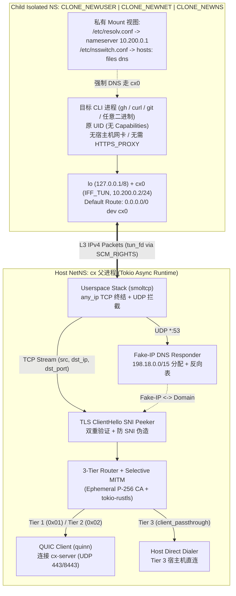
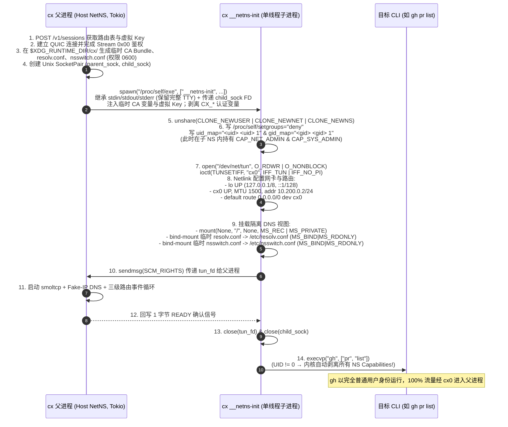

# `cx` Linux Rootless NetNS 透明流量拦截方案

> **文档编号**: SPEC-003  
> **关联文档**: [SPEC-001: 总体架构设计](./001-cx-architecture.md) · [SPEC-002: 插件化域名与凭据注入系统](./002-plugin-system.md)  
> **所属模块**: `crates/cx-netns` + `crates/cx-proxy`  
> **目标**: 在无需 `root`/`sudo`、不修改宿主机任何全局网络配置的前提下，利用 Linux 无特权命名空间（User/Network/Mount Namespace）+ 虚拟网卡 `tun` + 用户态协议栈 `smoltcp` + Fake-IP DNS + TLS SNI，透明截获任意子进程（包括无视 `HTTPS_PROXY` 的二进制与不可信 AI Agent）的全部网络流量，并接入三级路由与 QUIC 隧道。

---

## 1. 架构总览：双侧隔离进程模型

由于隔离的 Network Namespace 内部**没有任何物理网卡**，负责与 `cx-server` 通信及宿主机直连透传的 `cx` 父进程必须停留在**宿主机网络命名空间（Host NetNS）**，而目标 CLI 子进程运行在**隔离命名空间（Child NetNS）**内。双方仅通过内核传递的单个 `tun_fd` 交换 L3 原始 IP 包：

---

## 2. 安全无 UB 的引导流程（Self-Re-Exec + `SCM_RIGHTS`）

在 Rust 多线程 Tokio 运行时中直接调用 `fork()` 会导致未定义行为（锁死锁）。因此采用标准的 **单线程自引导子进程（`/proc/self/exe __netns-init`）** 架构：

### 2.1 精确步骤与系统调用时序

### 2.2 关键 Linux 细节与避坑规范

1. **保持原始 UID 映射（`<uid> <uid> 1` 而非 `0 <uid> 1`）**：
   - 保持用户原始 UID/GID（如 `1000:1000`），避免子进程内创建的文件或读取 `~/.gitconfig` / `.git/` 出现 `root` 属主错乱；
   - 在 `unshare(CLONE_NEWUSER)` 后、`execvp` 前，Linux 内核会赋予该进程完整的子命名空间 Capabilities（足以配置 `tun`、Netlink 与 Bind Mount）；
   - 一旦调用 `execvp` 执行目标 CLI，由于新进程的 UID 不为 0，Linux 内核会**自动清空所有 Capabilities**，目标进程零特权运行。
2. **绕过 `systemd-resolved` D-Bus 漏洞（双文件 Bind-Mount）**：
   - Ubuntu / Fedora / Arch 等现代发行版默认在 `/etc/nsswitch.conf` 配置 `hosts: files resolve [!UNAVAIL=return] dns`，会导致 glibc（`curl`、`git`、`python`、`node`）通过 D-Bus 私有 Socket 直接问宿主机 `systemd-resolved`，绕过 `/etc/resolv.conf`；
   - 因此在 `CLONE_NEWNS` 中**同时私有 Bind-Mount** `/etc/resolv.conf`（`nameserver 10.200.0.1`）与 `/etc/nsswitch.conf`（仅保留 `hosts: files dns`，其他行从宿主机 `/etc/nsswitch.conf` 继承），确保所有 glibc 与 Go/Rust 程序统统走 `10.200.0.1:53`。
   - **符号链接处理**：若 `/etc/resolv.conf` 是指向 `/run/systemd/resolve/stub-resolv.conf` 的符号链接，先 `fs::canonicalize` 找到实际目标路径再执行 Bind-Mount；若为悬空符号链接，则先在 `/run/systemd/resolve/` 挂载小型 `tmpfs` 或直接覆盖挂载，确保在各种 Linux 发行版上均不报错。
3. **父进程退出防护**：
   - 子进程在 `execvp` 前设置 `prctl(PR_SET_PDEATHSIG, SIGTERM)`（可选开关），防止父进程异常崩溃时子进程沦为无网络孤儿；
   - 父进程捕获 `SIGINT`/`SIGTERM` 并转发给子进程，等子进程完全退出后关闭 `tun_fd`、优雅关闭 QUIC 连接、清理 `$XDG_RUNTIME_DIR/cx/` 临时文件并透传真实退出码。

---

## 3. Fake-IP DNS 与用户态网络栈（`smoltcp`）

### 3.1 虚拟网络地址规划

| 地址段 / 节点 | 规划值 | 用途 |
| :--- | :--- | :--- |
| 子进程虚拟网卡 `cx0` | `10.200.0.2/24` | 子进程源 IP，MTU = 1500 |
| 虚拟网关 & 内置 DNS | `10.200.0.1` | 子进程默认网关与 `nameserver` |
| Fake-IP 分配池 | `198.18.0.0/15`（RFC 2544） | 约 13.1 万个独立地址，永不与公网及常见 RFC1918 私网冲突 |

### 3.2 DNS 拦截与 Fake-IP 分配规则

父进程截获**所有发往任意目标 `UDP *:53` 与 `TCP *:53`** 的数据包（不仅限于 `10.200.0.1:53`，即使子进程硬编码 `8.8.8.8:53` 也会被无缝截获）：

1. 解析 DNS 请求中的 `QNAME`（规范化为小写并去除末尾 `.`）与 `QTYPE`。
2. 查当前会话的 `RoutingPolicy`：
   - **命中 `deny`**：直接返回 `REFUSED`（或 `NXDOMAIN`）并记录审计。
   - **命中 `inject` / `server_tunnel` / `server_http_passthrough` / `client_passthrough`**：
     - **`QTYPE == A`**：从 `198.18.0.0/15` 原子分配（或复用已有映射）一个 Fake-IP（如 `198.18.0.17`），记录 `FakeIpEntry { ip, domain, route_tier, created_at }`，返回 `A 198.18.0.17`（`TTL = 5s`）。
     - **`QTYPE == AAAA`**：返回 `NOERROR` 空记录（0 Answers），引导双栈客户端干净地走 IPv4 Fake-IP，彻底避免 IPv6 Happy-Eyeballs 竞态问题。
     - **其他记录类型（`TXT` / `SRV` / `MX` / `CNAME`）**：若策略允许 `client_passthrough`，在宿主机侧通过系统 Resolver 转发查询并返回。
   - *(特殊优化：所有 `inject` / `server_tunnel` 域名在本地完全不触发真实 DNS 解析，真正做到**零本地 DNS 泄露**，真实解析全部发生在 `cx-server` 端！)*

### 3.3 用户态 TCP 终结与 TLS SNI 双重识别

父进程使用 Rust 纯用户态网络栈 **`smoltcp`**（运行在专用 async task 中，通过 `tokio::io::unix::AsyncFd` 驱动 `tun_fd`）：

1. **全地址监听（`any_ip`）**：
   - 收到来自 `10.200.0.2:<sport>` 发往任意 `<dst_ip>:<dport>` 的 TCP `SYN` 后，动态创建一条 `smoltcp::socket::tcp::Socket` 与对应的 Tokio `AsyncRead + AsyncWrite` 通道流，交给连接分发器。
2. **域名识别与防伪造交叉校验（核心安全逻辑）**：
   - **步骤 1（Fake-IP 反查）**：若 `dst_ip ∈ 198.18.0.0/15`，查表得到 `dns_domain`；否则 `dns_domain = None`（说明子进程跳过了 DNS 直接按硬编码 IP 建连）。
   - **步骤 2（非破坏性首包窥探 — Peek Buffer）**：
     - 读取首包（设置短超时如 200ms，防止服务端先说话的协议如 SSH/SMTP 卡死！若超时无客户端首包则跳过窥探，直接按 `dns_domain` 或原始 IP 走非 TLS 分流）：
     - 若首包匹配 **TLS ClientHello**（`bytes[0] == 0x16 && bytes[1] == 0x03`）：用 `tls-parser` 解析 **SNI（Server Name Indication）** 得到 `sni_domain`；
     - 若首包匹配 **明文 HTTP 方法**（`GET / POST / PUT / DELETE / HEAD / PATCH / OPTIONS`）：解析 `Host:` Header 得到 `http_host`。
   - **步骤 3（安全交叉验证）**：
     - 当 `dns_domain` 与 `sni_domain` 同时存在，但二者不一致（如用 `evil.com` 的 Fake-IP 发送 `SNI=api.github.com` 企图域前置/混淆审计）→ **直接断开连接并记录安全告警**！
     - 当 `dns_domain == None`（程序用了 DoH 或硬编码 IP）但 `sni_domain` 命中 Tier 1/2 → **依然精准识别 `sni_domain` 并强制纳入路由**！
3. **重放窥探字节并进入三级路由**：
   - 将首包缓冲区与剩余流拼接为 `PrefixedStream`，无缝交付给：
     - **Tier 0 (`deny`)**：发送 TCP RST 关闭连接；
     - **Tier 1 (`inject`)** / **Tier 2b (`server_http_passthrough`)**：交付 `tokio-rustls::TlsAcceptor`（内存签发对应域名 Leaf Cert）→ `hyper` 解析 HTTP/1.1 & HTTP/2 → 开 QUIC Stream `0x01` 发往 `cx-server`；
     - **Tier 2a (`server_tunnel`)**：不解密 TLS → 开 QUIC Stream `0x02` (`ConnectMeta { host, port }`) → `copy_bidirectional` 原始密文透传；
     - **Tier 3 (`client_passthrough`)**：不解密 TLS、不经 `cx-server` → 父进程在 Host NetNS 中按 `(resolved_domain_or_ip, dport)` 发起真实 TCP 拨号 → `copy_bidirectional` 宿主机直连透传。

### 3.4 非 DNS UDP 流量处理（特别是 HTTP/3 / QUIC）

- **`UDP *:53`**：全部交由内置 Fake-IP DNS 应答器。
- **`UDP *:443` 命中 Tier 1（`inject`）域名**：
  - 立即返回 **ICMP Port Unreachable**（或静默丢弃），促使支持 HTTP/3 的现代客户端（如 `curl --http3`）按 RFC 9114 立即回退到 TCP 443，确保 L7 密钥注入不会因 HTTP/3 绕过。
- **其他 UDP 流量**：
  - 若 `default_action == "deny"`，全部丢弃；
  - 若 `default_action == "client_passthrough"`，按需提供轻量级 UDP NAT 转发（Phase 1.5/2，默认支持 ICMP/UDP 常见包）。

---

## 4. 环境依赖、边界说明与诊断（`cx doctor`）

### 4.1 Linux 宿主机运行前提

| 检查项 | 要求 | 说明与排查 |
| :--- | :--- | :--- |
| Linux 内核 | ≥ 5.10（推荐 ≥ 5.15） | 支持完整无特权 User/Net/Mount Namespace |
| `/dev/net/tun` | 存在且当前用户可读写（通常默认 `0666`） | 绝大多数桌面/服务器 Linux 默认满足 |
| Unprivileged UserNS | 允许普通用户 `unshare(CLONE_NEWUSER)` | Ubuntu 24.04+ 若启用 `kernel.apparmor_restrict_unprivileged_userns=1`，需为 `cx` 安装一条 5 行 AppArmor Profile 放行 `userns` |

`cx doctor` 会自动执行上述所有探测（尝试创建临时 `CLONE_NEWUSER|CLONE_NEWNET` + 打开 `/dev/net/tun` + 验证 `cx-server` HTTPS/QUIC 连通性），如遇到 Ubuntu 24.04 AppArmor 限制或受限 Docker 容器，直接打印精确的修复命令（或在容器内提示使用备用 `--mode proxy`）。

### 4.2 已知边界与处理方式

1. **宿主机 `127.0.0.1` 服务访问**：
   - 在隔离的 `CLONE_NEWNET` 中，`127.0.0.1` 是子进程私有的 `lo` 网卡，**默认无法访问宿主机上仅监听 `127.0.0.1` 的其他进程**（这在安全沙箱视角下反而是优点）。
   - Unix Domain Socket（如 `/var/run/docker.sock`、SSH Agent Socket）因共享文件系统视图仍可按权限正常访问；若确需访问宿主机某个本地 TCP 端口，后续可通过 `--expose-host-port 11434` 显式映射至网关 `10.200.0.1:11434`。
2. **硬编码 `webpki-roots` 的静态二进制（极少数）**：
   - 绝大多数 Linux 工具（Go `gh`、OpenSSL `curl`/`git`、Python、Node.js、Rust `native-certs`）均自动信任 `SSL_CERT_FILE`；对于个别编译期硬编码根证书且忽略 `SSL_CERT_FILE` 的工具，可配合 Phase 2 的本地明文 Base-URL 反向代理模式处理。
